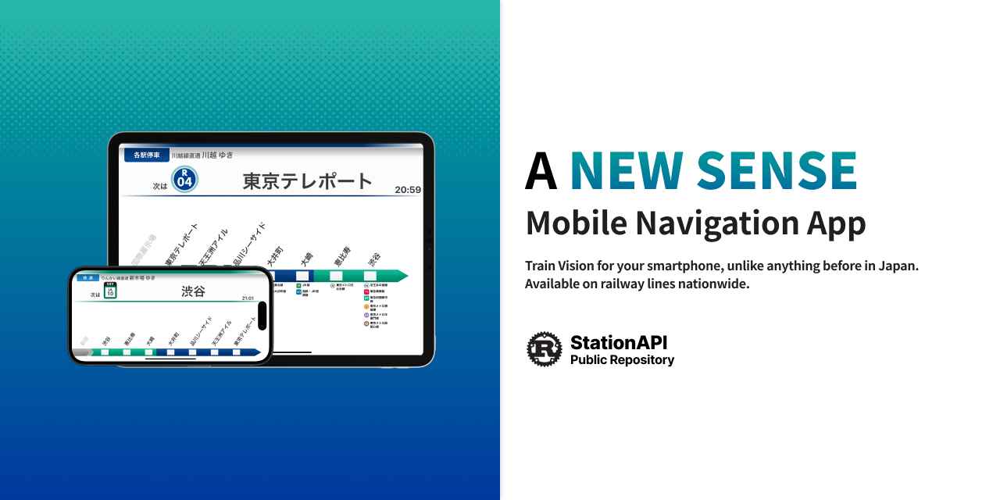

# StationAPI



<!-- ALL-CONTRIBUTORS-BADGE:START - Do not remove or modify this section -->
[](#contributors-)
<!-- ALL-CONTRIBUTORS-BADGE:END -->

A GraphQL API that provides nearby Japanese train stations and bus stops, running on Cloudflare Workers.

## Documentation

- For automation agent and contributor workflows, see [AGENTS.md](AGENTS.md).
- For contribution guidelines, see [CONTRIBUTING.md](CONTRIBUTING.md).
- For system architecture and design decisions, see [docs/architecture.md](docs/architecture.md).

- For the design of the transfer route search (`connectedRoutes`, RAPTOR), see [docs/route-search.md](docs/route-search.md).
- For the source-backed operating constraints used by timetable-free search, see [docs/route-service-audit.md](docs/route-service-audit.md).
- For the Keio stopping-pattern audit and regression checks, see [docs/keio-stopping-pattern-audit.md](docs/keio-stopping-pattern-audit.md).
- For technical debt analysis and architectural concerns, see [docs/technical_debt.md](docs/technical_debt.md).
- For the record of the Cloudflare Workers migration, see [docs/cloudflare-workers-migration.md](docs/cloudflare-workers-migration.md).
- For the published GraphQL schema, see [schema/public.graphql](schema/public.graphql).

## Data Contribution

This project includes a comprehensive dataset of Japanese railway information in the `data/` directory. The data is maintained in CSV format and contributions are primarily targeted at Japanese speakers. For detailed information about data structure and contribution guidelines, please refer to [data/README.md](data/README.md).

## Data Sources

- Track lengths between adjacent stations (`Station.trackDistanceFromPrevious`) are
  derived from the MLIT National Land Numerical Information railway data (N02),
  licensed under CC BY 4.0:
  「国土数値情報（鉄道データ）」（国土交通省）
  (https://nlftp.mlit.go.jp/ksj/gml/datalist/KsjTmplt-N02-2025.html) を加工して作成
- Bus stops and routes are derived from the GTFS and ODPT feeds listed in
  `preprocessor/src/gtfs/feed.rs` and `preprocessor/src/gtfs/odpt.rs`.
- Nagoya City Bus routes and stops use the Transportation Bureau, City of Nagoya
  [GTFS-JP dataset (2026-03-28)](https://data.bodik.jp/dataset/231002_7109030000_bus-gtfs-jp/resource/125a1d12-7df6-489c-abde-911856e05d1b),
  [CC BY 4.0](https://creativecommons.org/licenses/by/4.0/), processed for TrainLCD.
- Hokkaido Chuo Bus routes and stops use the [GTFS feed published on HODA](https://ckan.hoda.jp/dataset/gtfs-data/resource/dbadfccc-670e-49b9-be77-c3f346ee3160)
  (Jorudan, [CC BY 4.0](https://creativecommons.org/licenses/by/4.0/)), processed for TrainLCD.
- Hokkaido express bus routes and stops use the [Highway Express Bus GTFS feed published on HODA](https://ckan.hoda.jp/dataset/gtfs-data/resource/ccfd2358-c804-4cfe-b4fe-278c3f035c64)
  (Jorudan, [CC BY 4.0](https://creativecommons.org/licenses/by/4.0/)), processed for TrainLCD.
- Jotetsu Bus routes and stops use the [GTFS feed published on HODA](https://ckan.hoda.jp/dataset/gtfs-data/resource/fef98fef-6fe2-472f-bde3-9d4f0a509a4a)
  (Jorudan, [CC BY 4.0](https://creativecommons.org/licenses/by/4.0/)), processed for TrainLCD.
- Chiyoda Kazaguruma routes and stops use the [GTFS feed from Hitachi Automobile Transportation](https://ckan.odpt.org/dataset/hitachi_automobile_transportation_chiyoda_alllines)
  ([CC BY 4.0](https://creativecommons.org/licenses/by/4.0/)), processed for TrainLCD.
- Bunkyo B-guru routes and stops use the [GTFS feed from Hitachi Automobile Transportation](https://ckan.odpt.org/dataset/hitachi_automobile_transportation_all_lines)
  ([CC BY 4.0](https://creativecommons.org/licenses/by/4.0/)), processed for TrainLCD.
- Nagoya City SRT bus routes and stops use the Nagoya City Housing and City Planning
  Bureau GTFS (2026-09-11), [CC BY 4.0](https://creativecommons.org/licenses/by/4.0/),
  [source](https://ckan.odpt.org/dataset/nagoya_housing_city_planning_bureau_nagoya_srt_all_lines/resource/a7588aea-27fd-4962-b39a-912209f19a1b), processed for TrainLCD.
- Odakyu Bus routes and stops use the [GTFS feed from Odakyu Bus Co., Ltd.](https://ckan.odpt.org/dataset/odakyu_bus_aii_lines)
  ([Public Transportation Open Data Basic License](https://developer.odpt.org/terms/data_basic_license.html)), processed for TrainLCD.
- Nishi Tokyo Bus routes and stops use the [GTFS feed from Nishi Tokyo Bus Co., Ltd.](https://ckan.odpt.org/dataset/nishi_tokyo_bus_nt_bus)
  ([Public Transportation Open Data Basic License](https://developer.odpt.org/terms/data_basic_license.html)), processed for TrainLCD.
- Minato Chiibus routes and stops use the [GTFS feed from Fuji Express](https://bus.fujikyu.co.jp/rosen/gtfs/)
  ([CC BY](https://search.ckan.jp/datasets/catalog.data.metro.tokyo.lg.jp__dataset:t131032d0000000243)), processed for TrainLCD.
- Some of the reference travel times in `travel_times/cases.csv` are derived from
  the Toei Subway GTFS (Bureau of Transportation, Tokyo Metropolitan Government,
  CC BY 4.0) and from the Tokyo Metro, Metropolitan Intercity Railway (Tsukuba
  Express), Tokyo Waterfront Area Rapid Transit (Rinkai Line), and Tama Toshi
  Monorail GTFS feeds published by the Public Transportation Open Data Center
  under the Public Transportation Open Data Basic License.

## Contributors ✨

Thanks goes to these wonderful people ([emoji key](https://allcontributors.org/emoji-key)):

<!-- ALL-CONTRIBUTORS-LIST:START - Do not remove or modify this section -->
<!-- prettier-ignore-start -->
<!-- markdownlint-disable -->
<table>
  <tbody>
    <tr>
      <td align="center" valign="top" width="14.28%"><a href="https://sw-saturn.dev"><br /><sub><b>Kanta Demizu</b></sub></a><br /><a href="#data-Sw-Saturn" title="Data">🔣</a> <a href="#infra-Sw-Saturn" title="Infrastructure (Hosting, Build-Tools, etc)">🚇</a> <a href="https://github.com/TrainLCD/StationAPI/commits?author=Sw-Saturn" title="Code">💻</a></td>
      <td align="center" valign="top" width="14.28%"><a href="https://nrsy.jp"><br /><sub><b>SAIGUSA Tomotada</b></sub></a><br /><a href="#ideas-10mocy" title="Ideas, Planning, & Feedback">🤔</a> <a href="#data-10mocy" title="Data">🔣</a></td>
      <td align="center" valign="top" width="14.28%"><a href="https://github.com/mittan12"><br /><sub><b>mittan12</b></sub></a><br /><a href="#data-mittan12" title="Data">🔣</a></td>
      <td align="center" valign="top" width="14.28%"><a href="http://coderabbit.ai"><br /><sub><b>CodeRabbit</b></sub></a><br /><a href="https://github.com/TrainLCD/StationAPI/pulls?q=is%3Apr+reviewed-by%3Acoderabbitai" title="Reviewed Pull Requests">👀</a></td>
      <td align="center" valign="top" width="14.28%"><a href="https://github.com/tahodev/kurashi-skill"><br /><sub><b>tahodev</b></sub></a><br /><a href="https://github.com/TrainLCD/StationAPI/commits?author=tahodev" title="Code">💻</a></td>
    </tr>
  </tbody>
</table>

<!-- markdownlint-restore -->
<!-- prettier-ignore-end -->

<!-- ALL-CONTRIBUTORS-LIST:END -->

This project follows the [all-contributors](https://github.com/all-contributors/all-contributors) specification. Contributions of any kind welcome!

## Join our community(Japanese only)

Do you like this project? Join our Discord community!
[https://discord.gg/tsemdME9Nz](https://discord.gg/tsemdME9Nz)

## Development

No database is required. The data is generated into `generated/*.csv` and embedded
into the WASM binary at build time.

```bash
rustup target add wasm32-unknown-unknown
cargo install worker-build --locked

make data     # build generated/*.csv from data/, the GTFS feeds, and the MLIT railway data
make build    # build the Worker (wasm)
make dev      # run it locally on http://127.0.0.1:8787
```

`make help` lists every target.

### Testing

```bash
make test     # unit tests for every native crate
make check    # type-check, including the wasm32 target
make clippy   # lint, including the wasm32 target
make fmt      # formatting check
```

Tests need no external services. `stationapi` (domain / use case) and
`preprocessor` (data pipeline) are covered by unit tests; the published GraphQL
schema is verified in CI by diffing the Worker's SDL against
[`schema/public.graphql`](schema/public.graphql).

### Deploying

```bash
make deploy             # staging   -> stationapi-stg
make deploy-production  # production -> stationapi
```

The data lives inside the WASM binary, so **a data change needs a rebuild and a
redeploy**; it is not picked up at runtime.

